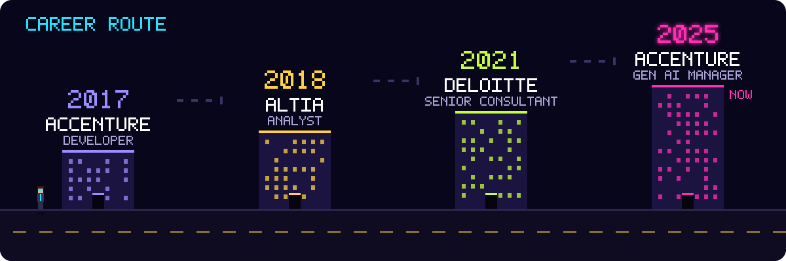
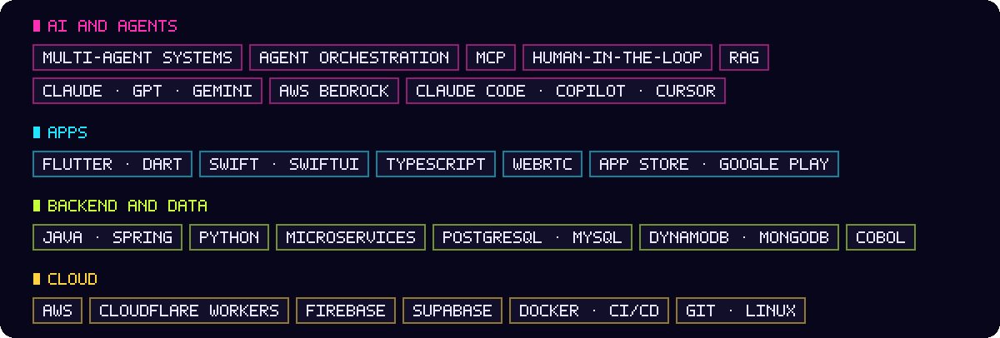

  <a href="https://rodrigodavila.com"><b>rodrigodavila.com</b></a>
  &nbsp;·&nbsp;
  <a href="https://www.linkedin.com/in/rodrigo-d%C3%A1vila-5b675383/">LinkedIn</a>
  &nbsp;·&nbsp;
  <a href="mailto:rdavila92@gmail.com">rdavila92@gmail.com</a>
  &nbsp;·&nbsp;
  Madrid

 

I design **multi-agent systems** for banking and build **my own apps, from idea to store**.

- 🏦 **Right now:** modernising BBVA's core banking with AI. Specialised agents read decades-old COBOL, understand its business logic and bring it to modern Java, coordinated by an orchestrator, with MCP tools and human validation on every critical decision.
- 🎤 **Also:** workshops and live demos so thousands of professionals at Accenture learn what AI can and cannot do.
- 📱 **After hours:** apps on the App Store and Google Play, used by real people.

 

## Apps I have built

<table>
  <tr>
    <td align="center" width="25%" valign="top">
       
      <b>UrbaPadel</b> 
      Your community's bookings, without WhatsApp groups. 150+ residents. 
      <a href="https://apps.apple.com/es/app/urbapadel/id6743709716">App Store</a> · <a href="https://play.google.com/store/apps/details?id=com.rd.urbapadel">Google Play</a>
    </td>
    <td align="center" width="25%" valign="top">
       
      <b>LullCam</b> 
      Your iPhone or iPad as a baby monitor. No accounts, no cloud, no recordings. 
      <a href="https://apps.apple.com/es/app/lullcam/id6820272090">App Store</a> · <a href="https://lullcam.com">Web</a>
    </td>
    <td align="center" width="25%" valign="top">
       
      <b>TuMenu</b> 
      The bar sends its menu over WhatsApp and AI turns it into a professional image. 
      <a href="https://apps.apple.com/es/app/tumen%C3%BA-bar/id6821579170">App Store</a> · <a href="https://play.google.com/store/apps/details?id=com.RD.tumenu">Google Play</a>
    </td>
    <td align="center" width="25%" valign="top">
       
      <b>GodaFly</b> 
      For solo travellers: find other people on your layover. 
      <a href="https://apps.apple.com/es/app/godafly/id6758113933">App Store</a> · <a href="https://play.google.com/store/apps/details?id=com.godafly.godafly">Google Play</a>
    </td>
  </tr>
  <tr>
    <td align="center" valign="top">
       
      <b>Mi Filmoteca</b> 
      Your films and series: what you've watched, what's next and where to watch it. ★ 4.5 
      <a href="https://apps.apple.com/es/app/mifilmoteca/id1508750379">App Store</a> · <a href="https://play.google.com/store/apps/details?id=com.rodrigodavila.mifilmoteca">Google Play</a>
    </td>
    <td align="center" valign="top">
       
      <b>Zapeo</b> 
      All your multimedia content in one app, on phone, tablet, desktop and TV. 
      <i>Coming to the stores</i>
    </td>
    <td align="center" valign="top">
       
      <b>RunClap</b> 
      Group runs near you: meet-ups on a map, pace and meeting point. 
      <i>Private beta</i>
    </td>
    <td align="center" valign="top">
       
      <b>Websites</b> 
      My products' sites, plus custom websites for weddings, restaurants and shops. 
      <a href="https://rodrigodavila.com">rodrigodavila.com</a>
    </td>
  </tr>
</table>

 

## Career

 

## Stack

 

## Contributions

 

  <a href="https://rodrigodavila.com"><b>Walk the whole city at rodrigodavila.com →</b></a> 
  Game mode, an AI assistant that has read my CV, and every project in detail.

